<div align="center">



[](https://github.com/diogenesmedeiros)
[](https://www.linkedin.com/in/diogenesmedeirosy/)
[](https://discord.com/users/562758552456921110)
[](https://ctf.hackthebox.com/user/profile/819115)
[](https://tryhackme.com/p/zyz814)


</div>

---

## <samp>❯ whoami</samp>

```bash
$ whoami --verbose
```

```yaml
nome:     Diógenes Júnior
papel:    Backend Developer | Cyber Security
local:    Brasil
foco:
  - construir backends que aguentem produção
  - quebrar backends antes que alguém quebre por mim
daily_driver: Debian
```

Desenvolvo **APIs e serviços backend** com Java/Spring, PHP/Laravel, .NET, Node e Python — pensando em
**microsserviços, mensageria e integrações REST** desde o primeiro commit. Em paralelo, atuo em
**segurança ofensiva**: pentest, red team, exploit development, engenharia reversa e análise de malware,
treinando em plataformas como **Hack The Box** e **TryHackMe**.

<br>

## <samp>❯ segurança ofensiva</samp>

<div align="center">


<br>


</div>

<br>

## <samp>❯ stack</samp>

<table>
  <tr>
    <td align="center" width="180"><b>Linguagens</b></td>
    <td></td>
  </tr>
  <tr>
    <td align="center"><b>Frameworks</b></td>
    <td></td>
  </tr>
  <tr>
    <td align="center"><b>Dados & Mensageria</b></td>
    <td></td>
  </tr>
  <tr>
    <td align="center"><b>Infra & DevOps</b></td>
    <td></td>
  </tr>
  <tr>
    <td align="center"><b>Sistemas & Tools</b></td>
    <td></td>
  </tr>
</table>

<div align="center">


</div>

<br>

## <samp>❯ github --stats</samp>

<div align="center">


</div>

<br>

## <samp>❯ contribuições</samp>

<div align="center">
  <picture>
    <source media="(prefers-color-scheme: dark)" srcset="https://raw.githubusercontent.com/diogenesmedeiros/diogenesmedeiros/output/github-contribution-grid-snake-dark.svg" />
    <source media="(prefers-color-scheme: light)" srcset="https://raw.githubusercontent.com/diogenesmedeiros/diogenesmedeiros/output/github-contribution-grid-snake.svg" />
    
  </picture>
</div>

<br>

## <samp>❯ contato</samp>

<div align="center">

| Plataforma | Perfil |
|:--|:--|
| `LinkedIn` | [diogenesmedeirosy](https://www.linkedin.com/in/diogenesmedeirosy/) |
| `Hack The Box` | [profile/819115](https://ctf.hackthebox.com/user/profile/819115) |
| `TryHackMe` | [zyz814](https://tryhackme.com/p/zyz814) |
| `Discord` | [562758552456921110](https://discord.com/users/562758552456921110) |

</div>

<div align="center">
  <br>
  <sub><i>"Security is not a product, but a process."</i> — Bruce Schneier</sub>
</div>


